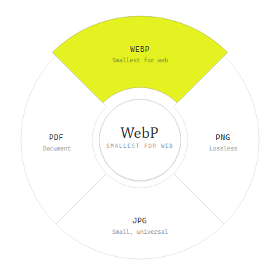
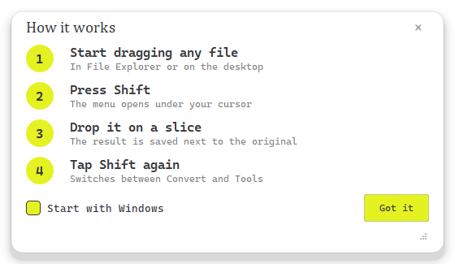

# PROMETHEA Drop

## Исходный код и лицензии

Исходный код проекта и изменений распространяется по [MIT License](LICENSE),
с сохранением уведомлений авторов DragShift. Лицензии сторонних компонентов
применяются отдельно: в частности, PyMuPDF доступен по AGPL-3.0 или коммерческой
лицензии, а текущий бинарный wheel pillow-heif включает компоненты с другими
условиями. См. [NOTICE](NOTICE.md) и [аудит лицензий](docs/LICENSE_AUDIT.md).

Сам по себе MIT-текст не заменяет выполнение условий зависимостей при выпуске
собранного приложения. Текущий preview ещё не подготовлен к распространению:
для точных бинарных зависимостей не подтверждены полный комплект уведомлений,
соответствующие исходники и совместимость лицензий. Локальный архив исходного
кода проекта можно сформировать командой `python scripts/package-source.py`;
его ограничения описаны в [документе о комплекте исходников](docs/OPEN_SOURCE.md).

Форк [DragShift](https://github.com/llamaboi55/DragShift) (MIT) под бренд PROMETHEA:
перетащите файл, нажмите **Shift** — под курсором открывается меню, бросьте файл
на нужный сектор. Результат сохраняется **рядом с оригиналом**, исходник не меняется.


Светлая тема: белые карточки, тонкие линии, графитовый текст и один акцент —
лайм `#E4F222`, который появляется только на выбранном секторе и на главной
кнопке. Стекла больше нет: ни размытия, ни преломления, ни снимков экрана под
окном.

## Что изменено относительно DragShift

| Область | Было | Стало |
|---|---|---|
| Поверхности | liquid glass: блюр, преломление, снимок экрана | светлые карточки: `#FFFFFF` на фоне `#EEECE6`, линия 13 % графита |
| Палитра | синие акценты `#5ac8ff/#2f7bff`, радужный обод | графит `#34373A` + лайм `#E4F222`, затемнённый `#5F6B10` для текста |
| Меню | сектора-линзы из стекла, белый текст, блики | радиальные сектора вплотную (шов 1,6°) с тонкой линией, тёмный текст, лайм на наведении |
| Тени | свечение и радужная дисперсия | мягкая нейтральная тень под карточкой |
| Типографика | uppercase с трекингом («TOOLS») | **Cakra** (вшита в приложение) для всего интерфейса, моно-цифры для размеров |
| Иконки | глифы `⇲ ⓘ ▮ ⌗ ☼` | без иконок в меню; в остальном интерфейсе — только текст |
| Иконка приложения | голубое кольцо | авторский знак: чёрная плитка с белым вырезом |
| Имя, пакет, папки | DragShift | PROMETHEA Drop / `promethea` |
| Сборка | `DragShift.spec` | `Promethea.spec`, `PrometheaDrop.exe` |

Функциональность апстрима сохранена: конвертация (JPG/PNG/WebP/HEIC/AVIF/TIFF/BMP/GIF/ICO/PDF),
инструменты (сжатие, ресайз, кроп, аннотации, редактирование, метаданные, фон),
PDF (объединить, разделить, повернуть, сжать, пароль, извлечь), DOCX/TXT → PDF,
уведомления с Open · Show · Undo, трей, автозапуск.


## Аудио, видео и дополнительные форматы

- Аудио: MP3, WAV, OGG/Vorbis, Opus, M4A/AAC и FLAC.
- Видео: MOV, MP4, MKV, AVI, WebM и M4V → MP3, WAV или GIF; поддерживаемые видеофайлы → MP4 (H.264/AAC). Извлекается первая аудиодорожка. GIF ограничен 15 кадрами/с и шириной 720 px.
- SVG → PNG; DOCX → JPG (по изображению на страницу). Качество преобразования DOCX зависит от доступности Microsoft Word и сложности исходного документа.
- Медиадвижок FFmpeg включён в сборку Windows; сторонние лицензии и сведения для распространения указаны в NOTICE.md и vendor/ffmpeg.

## Экраны

| Меню, наведение | Настройки |
|---|---|
|  |  |

| Первый запуск | Другой формат |
|---|---|
|  |  |

Плотное кольцо на девять форматов и уведомление о результате: `docs/menu-nine.png`, `docs/toast.png`.

## Запуск из исходников

```powershell
python -m venv .venv
.\.venv\Scripts\python.exe -m pip install -r requirements.txt
.\.venv\Scripts\python.exe -m promethea
```

Сборка:

```powershell
.\.venv\Scripts\python.exe -m pip install pyinstaller
.\scripts\build.ps1                # onedir: dist\PrometheaDrop\PrometheaDrop.exe
.\scripts\build.ps1 -OneFile       # один файл: dist\PrometheaDrop.exe
.\scripts\build.ps1 -Sign <thumbprint>   # подписать сертификатом Code Signing
```

## Антивирус и ложные срабатывания

Kaspersky сообщает `PDM:Trojan.Win32.Generic` на onefile-сборку. Это поведенческая
эвристика: PyInstaller распаковывает себя в `%TEMP%`, приложение опрашивает
`GetAsyncKeyState`, чтобы поймать Shift во время перетаскивания, и файл не подписан.
Вредоносного кода в проекте нет.

Что делать: собирать **onedir** (`scripts\build.ps1` без `-OneFile`) — это убирает
самораспаковку; подписать exe сертификатом; отправить файл в лабораторию как ложное
срабатывание. Готовый текст заявки и адреса — в [docs/false-positive.md](docs/false-positive.md).

## Шрифты

Структура как у Nothing: служебный текст — моно, крупное — засечками. Оба семейства
системные и **не вшиваются** в дистрибутив, поэтому лицензионных ограничений нет.

| Роль | Семейство | Резерв |
|---|---|---|
| Заголовки, крупные цифры, хаб меню | **Cambria** | Georgia → Constantia → Times New Roman → Noto Serif → DejaVu Serif |
| Подписи, кнопки, поля, мета, лепестки меню | **Cascadia Mono** | Consolas → Lucida Console → Courier New → Menlo → DejaVu Sans Mono |

Кириллица есть у обоих, так что локализация не потребует менять шрифты.
Подписи секторов рисуются капсом с трекингом 1 px, хаб — засечками 22 px и моно-подписью 7.5 px.
Выбор идёт через `util.ui_family(display=True|False)`: `True` — засечки, `False` — моно.

Альтернативы, которые лежат на машине и подходят под ту же структуру (см. `docs/type-pairs.png`):
Aspid Mono + Lancetta Serif и Even Mono + Bibliografica из коллекции Bolditalic Studio —
ближе к референсу, но это **Trial**-версии, для продажи нужна лицензия; NType 82 —
родной шрифт Nothing, без кириллицы и тоже не для распространения.

## Проверки и снимки

```powershell
.\.venv\Scripts\python.exe -m pytest -q          # 21 тест
.\.venv\Scripts\python.exe -m promethea --selftest
.\.venv\Scripts\python.exe scripts\shots.py      # меню, настройки, приветствие
.\.venv\Scripts\python.exe scripts\shot-tool.py  # окно инструмента
.\.venv\Scripts\python.exe scripts\shot-toast.py # уведомление
```

`scripts/make_brand_assets.py` пересобирает иконки, `scripts/check_encoding.py`
ищет повреждённую кодировку (PowerShell 5.1 иногда портит не-ASCII).

## Документация

Полный контекст разработки, решения и карта проекта — [docs/HANDOFF.md](docs/HANDOFF.md).
Антивирусные ложные срабатывания — [docs/false-positive.md](docs/false-positive.md).

## Ограничения

1. **PyMuPDF — AGPL** (или коммерческая лицензия): на нём держатся PDF-инструменты
   и часть DOCX-рендера. Для продажи нужна лицензия Artifex либо замена PDF-слоя.
2. Интерфейс пока английский — это язык апстрима. Локализация — отдельный проход
   по copy (меню, настройки, приветствие, уведомления).
3. Сборка под macOS/Linux (`install-mac.sh`, `packaging/`, `installer/`, `.github/`)
   осталась с именами DragShift.

## Лицензия

MIT. Оригинал: © 2026 DragShift contributors. Изменения и бренд PROMETHEA: © 2026 PROMETHEA.
Дизайн-проход выполнен по методике [unslop](https://github.com/heydamir/unslop) (CC BY 4.0, Damir Sokolovsky).
