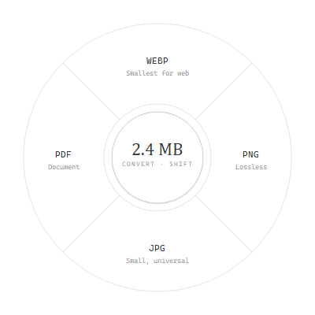
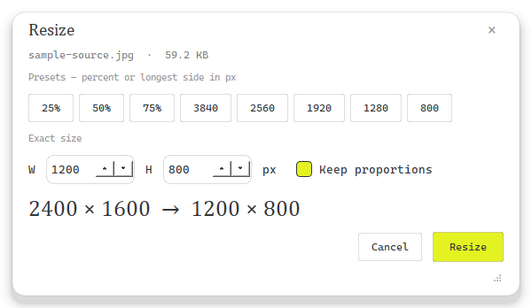

<div align="center">

# PROMETHEA Drop

**Быстрые действия с файлами — одним жестом.**

Перетащите файл · нажмите **Shift** · выберите действие в радиальном меню

[Возможности](#возможности) · [Как пользоваться](#как-пользоваться) · [Запуск](#запуск) · [Интерфейс](#интерфейс)

</div>

---

## Возможности

| Файлы | Что можно сделать |
|---|---|
| **Изображения** | Конвертировать, сжать, изменить размер, обрезать, настроить цвет, добавить аннотацию или фон |
| **PDF** | Объединить, разделить, повернуть, сжать, защитить паролем, извлечь изображения и управлять метаданными |
| **Документы и текст** | Преобразовать PDF, DOCX и TXT в доступные форматы |
| **Аудио и видео** | Конвертировать аудио, извлечь звук из видео или создать GIF |
| **Метаданные** | Посмотреть сведения о файле; для поддерживаемых форматов — отредактировать их |

Среди поддерживаемых форматов изображений — PNG, JPG, WebP, HEIC, AVIF, TIFF, BMP, GIF и ICO. Доступные действия зависят от типа выбранного файла.

## Как пользоваться

1. Запустите приложение: оно появится в системном трее.
2. Начните перетаскивать файл в Проводнике и нажмите **Shift**.
3. Переместите файл на нужный сектор радиального меню.

Клавишу вызова можно изменить в настройках на Ctrl или Alt. Результат сохраняется рядом с оригиналом; в уведомлении доступны открытие результата, переход к нему и отмена операции.

## Запуск

**Готовый EXE пока не опубликован на GitHub.** Здесь доступны исходники проекта; когда появится готовая сборка, её можно будет найти в разделе [Releases](../../releases).

Для запуска **из исходников на Windows** нужны Python и зависимости из `requirements.txt`:

```powershell
python -m venv .venv
.\.venv\Scripts\python.exe -m pip install -r requirements.txt
.\.venv\Scripts\python.exe -m promethea
```

Для обработки аудио и видео необходим FFmpeg. Для готовой Windows-сборки устанавливать Python отдельно не требуется.

## Интерфейс

| Радиальное меню | Выбор формата |
|:---:|:---:|
|  |  |

| Настройки | Изменение размера |
|:---:|:---:|
|  |  |

---

<div align="center">

**PROMETHEA** · инструменты для работы с файлами

</div>
