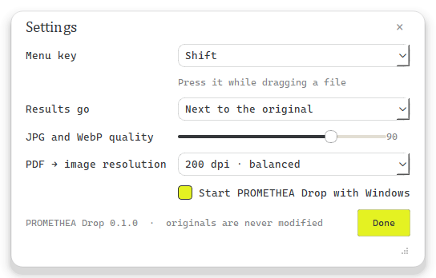

# PROMETHEA Drop

PROMETHEA Drop — приложение для работы с файлами через радиальное меню. Перетащите файл, нажмите **Shift** и выберите нужное действие. Результат сохраняется рядом с оригиналом.


## Возможности

- Конвертация изображений, аудио и видео.
- Сжатие, изменение размера, обрезка и редактирование изображений.
- Работа с PDF: объединение, разделение, поворот, сжатие, защита и извлечение.
- Преобразование документов и просмотр метаданных.
- Уведомления с быстрым доступом к результату и отмене действия.

## Запуск из исходников

```powershell
python -m venv .venv
.\.venv\Scripts\python.exe -m pip install -r requirements.txt
.\.venv\Scripts\python.exe -m promethea
```

## Скриншоты

| Меню | Настройки |
|---|---|
|  |  |

